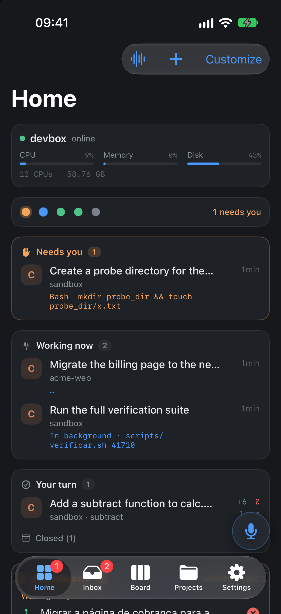
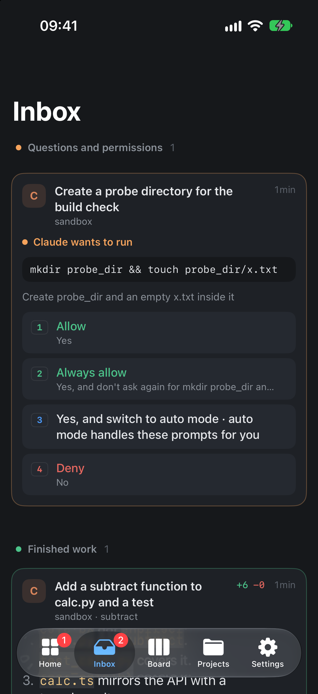
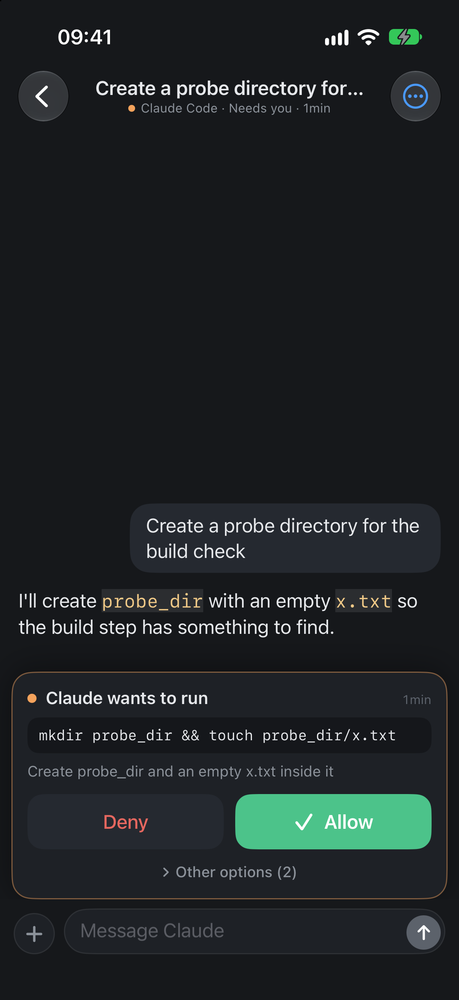
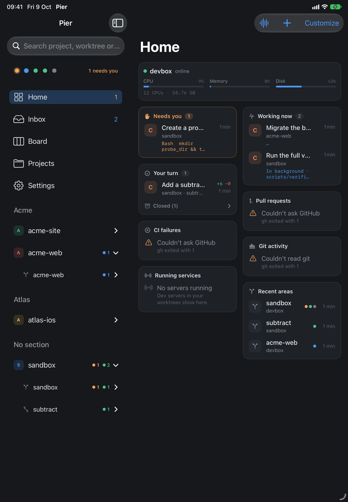
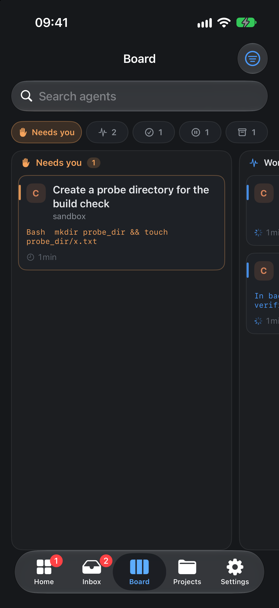
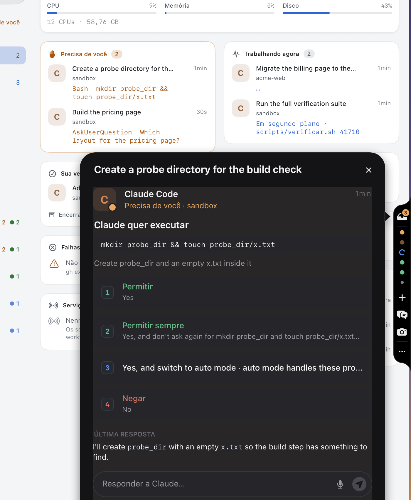
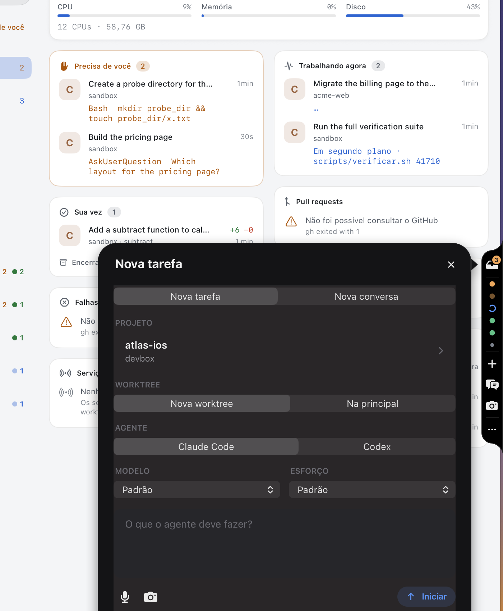

# Pier

**Your coding agents, in your pocket.** Pier is a native app for iPhone, iPad and Mac that lets you watch and drive the
coding agents (Claude Code, Codex) running on your development boxes — and **pierd**, the small server each box runs.

Agents ask; you answer in a tap or a keystroke, from anywhere. No agent sits waiting.

**[docktopier.com](https://docktopier.com/)** · [The film (0:52)](https://docktopier.com/#film) ·
[Privacy](https://docktopier.com/privacy.html) · [Support](https://docktopier.com/support.html). No box yet? The app's
first screen has a demo with sample projects and agents.

<p align="center">
  
  
  
</p>
<p align="center">
  
  
</p>
<p align="center">
  
  
</p>

## What it does

- **Every agent, every box, live.** One Home with who needs you, who is working and whose turn it is, plus status dots,
  pull requests, CI failures, git activity and running dev servers. The **Board** (kanban) groups every agent by state.
- **Inbox, keyboard first.** Every agent's questions and finished work in one list. Press `1` `2` `3` to answer,
  `J`/`K` to move, `E` to archive. Finished turns come with up to two **suggested next steps**, ready to send.
- **Answer anything.** Permission prompts (Allow / Always / Deny), multiple-choice questions, plan approvals and the
  agents' own startup dialogs become buttons. Every answer waits two seconds with **Undo** (or `Esc` / `⌘Z`).
- **Talk.** Say or type what you need; Pier picks the agent already on that work (or starts a new task), shows you the
  decision, and only then sends it — with a receipt.
- **A chat per session.** The transcript folded into turns, Markdown replies, diffs, background jobs and subagents, and
  the raw terminal one tap away.
- **Chats with no project.** Start Claude Code or Codex in a folder of its own to ask something, talk an idea through
  or plan something that does not exist yet (`⇧⌘N`).
- **Agents show their work.** With the `pier-prove` skill on, an agent captures what it changed — a page before and
  after a fix, at a desktop's width and a phone's (`pierd capture page`), or a simulator recording — and the pictures
  show as a gallery under its reply and on its Inbox card, full screen with a tap. A step's own screenshots (a browser
  MCP's) show in its detail.
- **Review and ship.** Changed files and diffs, commit / push / open a PR with an AI-written message, and a full
  **pull request** screen: checks, reviews, conversation, diffs, merge, comment, approve — or bring someone's PR into a
  worktree and continue it with an agent.
- **Keep the box tidy.** Ending a session can remove its worktree, stop its dev servers and fast-forward `main`;
  **Faxina** (cleanup) does it for the whole box, and can run daily from Shortcuts.
- **Notifications that carry the answer.** Push notifications with the agent's last reply (or a one-line AI recap);
  a question arrives with its choices as buttons, so it is answered from the Lock Screen; Live Activities on the Lock
  Screen and Dynamic Island, and Home Screen widgets.
- **The box needs you too.** A signed-out agent, missing hooks, a box out of reach: the Inbox says so, with the command
  to run.
- **One box, several people.** Each person runs their own pierd as their own user, with a box name and a range of
  dev-server ports of its own (`pierd setup --name … --ports …`).
- **Made for each device.** Tabs on iPhone; sidebar, command palette (`⌘K`) and menu shortcuts on iPad and Mac; light
  and dark.
- **Always there on the Mac.** A narrow black tab hanging from the edge of the screen, over every app: a dot per agent
  (working, needs you, done); under the pointer it grows into the Inbox, the agents, a new task, Talk and
  "point at it". Beside it, a dark panel with the app's work without the app's window: answer the Inbox with `1` `2` `3`
  (Esc undoes), read an agent's last reply and send it a next step, start a task or a chat, mark a part of the screen and
  say what should happen. Double-tap `⌥` (or `⌃⌥Space`) opens Talk from anywhere, `⌃⌥P` hides and shows the tab; desktop
  widgets too, and a menu bar item for those who hide the tab.

The AI touches (titles, recaps, commit messages, next steps, routing) run as `claude -p --model haiku` **on your box**,
with the subscription that is already there. The app holds no API keys.

## How it works

```
 iPhone / iPad / Mac                         your dev box (Linux)
┌──────────────────────┐   mutual TLS 1.3   ┌───────────────────────────────────────────┐
│ Pier app             │ ─── Ed25519 ─────▶ │ pierd                                     │
│  PierKit (Swift)     │   HTTP/2, /v1 API  │  sessions in tmux · Claude Code / Codex   │
│  pinned box key      │ ◀── event stream ─ │  hooks · transcripts · git worktrees ·    │
└──────────────────────┘                    │  dev servers (systemd) · exec · push      │
           ▲                                └───────────────────────────────────────────┘
           └──── APNs (alerts, Live Activities, widgets) ◀── pierd, with your APNs key
                 or iCloud (alerts) ◀── Pier on your Mac, with no key at all
```

- The app pairs with each box once, by scanning a QR code or pasting a `pier://` link. After that it talks to the box
  directly, or through a relay you run when the box is behind NAT: no account, no cloud. The box's key is pinned;
  each device has its own key and can be revoked.
- pierd runs agents in tmux, knows each agent's state from the agents' own hooks, reads their conversations, manages
  git worktrees and their dev servers, and sends push notifications through your own APNs key when it has one.
  Without one, Pier on your Mac tells your iPhone and iPad what needs you through your own iCloud.

## Requirements

- **Box:** a Linux server (x86-64 or arm64, systemd user units) or a Mac, with git, tmux and the agent CLIs you use
  (Claude Code, Codex), signed in. `gh` for the pull request features. No VPN needed: a server with a public address
  is reached directly.
- **App:** iOS/iPadOS 17+ or macOS (Mac Catalyst). To build it: Xcode 26 or newer and
  [XcodeGen](https://github.com/yonaskolb/XcodeGen).
- **Server build** (only to build pierd yourself): Go 1.25+ (standard library only).

## Getting started

### 1. Run pierd where your agents run

On a server, over SSH, or in Terminal on your Mac, as the user your agents run as:

```sh
curl -fsSL https://docktopier.com/install.sh | sh
```

Or `npm install -g pierd && pierd setup`, or `brew install wagnerfnds/tap/pierd && pierd setup`. It installs pierd as a
user service with the agents' hooks, adds the git repositories it finds (`~/code`, `~/Projects`, …) and prints a
single-use `pier://` link with its QR code. On a Linux server, `sudo loginctl enable-linger $USER` keeps pierd running
after you log out.

- **On a server**: scan the QR code with Pier on your iPhone or iPad, or paste the link in Pier on your Mac.
- **On your Mac**: the link opens Pier, which pairs with your Mac by itself. Then *Take it to iPhone* (at the end of
  the setup, or in Settings) shows a code for your phone.
- **From anywhere**: a Mac or a server at home is reached away from its network through the Pier tunnel, with
  nothing to set up: pierd connects out to it and pairing links carry the box's tunnel name. It only carries the
  end-to-end TLS, so it reads nothing; no VPN, no public address. `pierd relay off` turns it off, and `pierd relay use`
  points the box at a relay of your own instead.

`pierd pair` prints a new link any time and `pierd doctor` says what to fix. More in
[`Server/pierd/README.md`](Server/pierd/README.md) (flags, configuration, services, hooks, building it yourself).

### 2. The app

Pier for iPhone, iPad and Mac is coming to the App Store. To build it yourself:

```sh
brew install xcodegen
cp Config/Signing.example.xcconfig Config/Signing.xcconfig   # your DEVELOPMENT_TEAM and PIER_BUNDLE_ID
xcodegen generate
open Pier.xcodeproj
```

Every identifier (bundle ids, App Group, keychain groups, iCloud container, APNs topic) derives from
`PIER_BUNDLE_ID`. Simulator builds need no signing. For daily use on a device, build **Release** (Debug runs the TLS
stack unoptimised):

```sh
xcodebuild -project Pier.xcodeproj -scheme Pier -configuration Release \
  -destination 'generic/platform=iOS' -allowProvisioningUpdates build
```

The Mac app is the same target as Mac Catalyst (`-destination 'platform=macOS,variant=Mac Catalyst'`).

### 3. Push notifications

Nothing to set up: when a box sends no push of its own, Pier on your Mac relays what needs you to your iPhone and iPad
through your iCloud (Settings → *Tell my iPhone and iPad through iCloud*, on by default). It needs Pier open on a Mac
that is on ("Open Pier when the Mac starts").

With an app you build yourself, the box can also push by itself, Mac or not: create an APNs auth key (`.p8`) in your
Apple Developer account, put it on the box at `~/.config/pier/AuthKey.p8` (mode 0600) and write
`~/.config/pier/push.json`:

```json
{ "key_id": "ABC123DEFG", "team_id": "TEAMID1234", "bundle_id": "<your PIER_BUNDLE_ID>" }
```

Restart pierd (`systemctl --user restart pierd`). The app registers by itself. Details in [`docs/PUSH.md`](docs/PUSH.md).

## Security

- Mutual TLS 1.3 with Ed25519 on both sides; the app pins the box's public key, the box only answers paired clients.
- Pairing links are single use and expire in 10 minutes; `pierd clients` / `pierd revoke` manage devices.
- pierd listens on every interface by default (port 7444) and answers only paired devices; pairing needs the
  single-use link. `pierd setup --listen ADDR:PORT` limits it to one address (a VPN's, for instance). Behind NAT, a
  relay of your own (`pierd relay`) reaches a box from anywhere: it joins the app's connection to one the box opens,
  and the mutual TLS runs end to end inside, so it sees neither keys nor content.
- Commands that the app builds for the box (`exec`) pass user text base64-encoded, never interpolated into the shell.

Found a problem? Please open an issue (or a private advisory for anything sensitive).

## Development

```sh
cd Packages/PierKit && swift test                      # the Swift kit: transport, pairing, API, parsers
cd Server/pierd && go vet ./... && go test ./...       # the server
xcodebuild test -project Pier.xcodeproj -scheme Pier \
  -destination 'platform=iOS Simulator,name=iPhone 17' # UI tests against an in-memory mock box
```

`-uiTestMock 1` swaps every paired box for an in-memory one (`App/Debug/UITestMock.swift`): handy for UI work without a
server. `docs/ARCHITECTURE.md` lists the other launch arguments.

| Path | What |
|---|---|
| `App/` | the SwiftUI app (Core, DesignSystem, Features/*) |
| `Extensions/PierWidgets`, `Mac/PierMenuBar` | widgets (iPhone, iPad, Mac desktop) + Live Activities; the Mac's menu bar item, edge tab, toolbar and Inbox card |
| `Packages/PierKit` | transport (swift-nio-ssl), identity, pairing, typed API, models, parsers |
| `Server/pierd` | the box server (Go) |
| `Tools/pierctl` | a command-line client for end-to-end checks |
| `Vendor/swift-nio-ssl` | swift-nio-ssl with a small TLS-exporter patch used by pairing |
| `docs/` | [architecture](docs/ARCHITECTURE.md), [protocol](docs/PROTOCOL.md), [API](docs/API.md), [push](docs/PUSH.md) |

The UI speaks Brazilian Portuguese and English (String Catalogs); translations are welcome.

## Credits

- Third-party notices for pierd are in [NOTICE](NOTICE).
- [swift-nio-ssl](https://github.com/apple/swift-nio-ssl) and [SwiftNIO](https://github.com/apple/swift-nio) (Apache 2.0).

## License

MIT — see [LICENSE](LICENSE) and [NOTICE](NOTICE).
